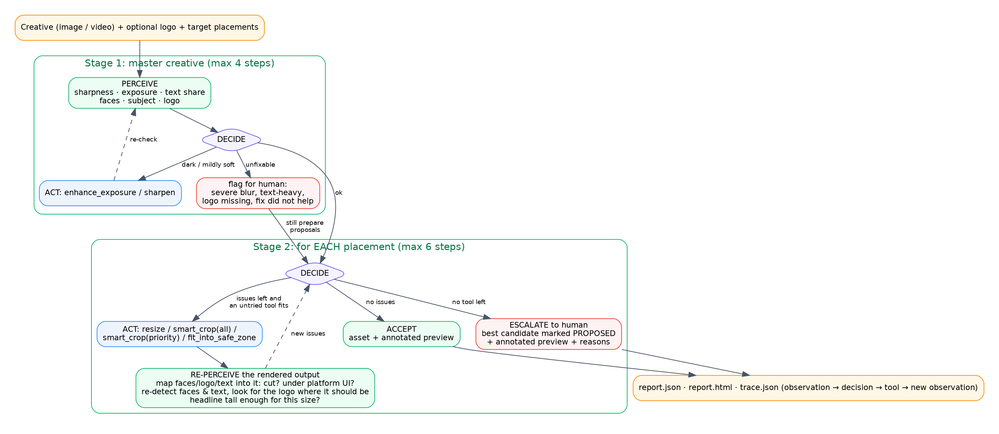
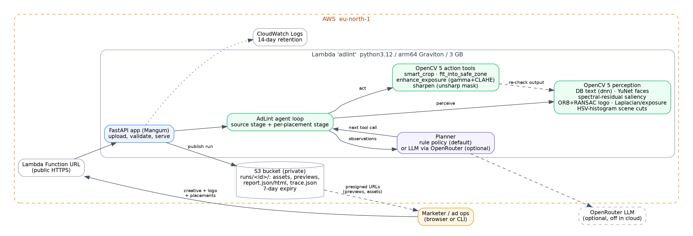

# AdLint Agent: technical report

OpenCV AI Competition 2026 (powered by AWS) · solo entry by Osama Romoh · targets the main prize and the Agentic Vision award.
Live demo: https://hkuqxujx6iftfyt6gcq2q64ewm0kndgt.lambda-url.eu-north-1.on.aws/

## 1. Problem and users

One campaign runs the same creative across many placements: 9:16 Stories and Reels, 1:1 and 4:5 feed,
16:9 YouTube, 300x250 display banners. Each placement has its own shape and its own **UI-covered zones**
(profile bar, caption, buttons, progress bar, skip button). Today people resize these by hand or with naive centre
crops, and the usual failures reach the live campaign: a face cut in half, the logo under the "Shop now" button, a
headline under the caption, a logo too small to read on a banner, a dark or soft master that nobody flagged.

**Users:** ad-ops and trafficking teams, media agencies, in-house brand teams and creative QA, i.e. the people who
are told after launch that "the logo isn't visible on Stories". AdLint sits between the design hand-off and the
ad-server upload: it prepares every placement it safely can and sends the rest to a human with a reason and an
annotated preview.

## 2. What the agent does

```
creative (+ logo, + placements) ─► Stage 1: master creative            ─► Stage 2: for each placement
                                   perceive → decide → fix → re-check      perceive → decide → reframe → RE-PERCEIVE output
                                   (exposure, mild softness)               → accept, try another tool, or escalate
```



* **Stage 1 (max 4 steps).** Perceive the master. If it is dark or flat, `enhance_exposure`; if mildly soft, `sharpen`;
  after each fix, perceive again. Severe blur, text-heavy layouts, blown-out exposure, a missing brand logo, or a fix
  that did not help: flag for a human (proposals are still produced for every placement).
* **Stage 2 (max 6 steps per placement).** If the aspect ratio matches, `resize`; otherwise `smart_crop(all)`.
  Every candidate is **rendered and perceived again**: faces, logo and text from the source are mapped into the output
  ("is any of it cut, is any of it under this platform's UI?"), faces and text are re-detected, the logo is looked
  for where it should have landed ("is it still recognisable at this size?"), and the headline height is checked
  against the placement's minimum. New issues decide the next call: `smart_crop(priority)` (faces + logo only),
  then `fit_into_safe_zone` (shrink onto a blurred backdrop), and if shrinking makes text or logo unreadable, back to a
  tighter crop. When no untried tool can fix what is left, it **escalates**: the least-bad candidate is saved as
  `<placement>_PROPOSED.jpg` with the reasons.

This is what makes it agentic in the competition's sense: **what the vision step sees changes the next tool call**,
the agent verifies its own output with the same vision step, the loop is bounded, and it asks a human when it
cannot fix something. A real excerpt from `demo_out/1_wide_hero/trace.json` (16:9 master, logo hugging the edge):

| step | placement | saw | decided | result after re-perceiving the output |
|---|---|---|---|---|
| 6 | reels_9x16 | aspect_mismatch | smart_crop(all) | face_cut, logo_cut, text_cut, text_in_ui_zone |
| 7 | reels_9x16 | (same) | smart_crop(priority) | still face_cut, logo_cut, text_cut, text_in_ui_zone |
| 8 | reels_9x16 | (same) | fit_into_safe_zone | no issues → accept |
| 17 | display_300x250 | aspect_mismatch | smart_crop(all) | logo_cut, logo_in_ui_zone, text_cut |
| 18 | display_300x250 | (same) | smart_crop(priority) | face_cut, face_in_ui_zone, logo_cut, logo_in_ui_zone |
| 19 | display_300x250 | (same) | fit_into_safe_zone | logo_not_redetected (the logo is 55 px wide) |
| 20 | display_300x250 | logo_not_redetected | **escalate** | PROPOSED asset + annotated preview for a human |

**Planners.** Both get the same structured context (stage, placement, current issues with details, metrics, tools
already tried) and return `{"action", "args", "reason"}`.
* *Rule policy* (default): a short, deterministic priority list. Always available, no network.
* *LLM planner* (optional): OpenRouter, default `deepseek/deepseek-v4.1-flash`, JSON mode, temperature 0, 30 s timeout,
  one retry on 429/5xx. Its answer is validated (known tool, valid args, not a repeat of a tried call, never "accept"
  while issues remain); anything invalid or failed falls back to the rule policy and the trace records why. The LLM
  only chooses among the vision tools: it never sees pixels and cannot invent actions.

**Video.** One pass computes per-frame exposure and sharpness and an HSV-histogram Bhattacharyya distance for scene
cuts. Keyframes (1 per second plus the first frame of each shot) are perceived. Per shot, the Stage 2 loop plans one
crop that protects everything seen in that shot, so the reframe can change at a cut. Video-level checks: dark and blurry
frame share, and the first 3 seconds (logo shown? dark? blurry? any face or text as a hook?). Output: one video per
placement (H.264 when ffmpeg exists, else VP8 WebM from OpenCV's own writer), a per-shot preview strip and a keyframe
contact sheet.

## 3. Architecture and AWS deployment



| layer | what | where |
|---|---|---|
| perception | `adlint/perception.py` | OpenCV 5 only |
| actions | `adlint/tools.py` | OpenCV 5 only |
| decisions | `adlint/planner.py` | rules, or LLM via HTTPS |
| loop + trace | `adlint/agent.py`, `adlint/video.py` | pure Python |
| outputs | `adlint/report.py` | previews, report.json, report.html, trace.json |
| interfaces | `adlint/cli.py`, `webapp/app.py` (FastAPI, one page), `lambda_handler.py` (Mangum) | |
| storage | `webapp/storage.py` | local disk, or S3 when `ADLINT_S3_BUCKET` is set |

**On AWS (eu-north-1)** the whole perceive-decide-act workload runs in the cloud:
* **AWS Lambda**, python3.12 on **arm64 (Graviton)**, 3008 MB, 300 s timeout, packaged as a 63 MB zip
  (169 MB unzipped, under Lambda's 250 MB limit) built for `manylinux_2_28_aarch64` by `aws/build_lambda.sh`.
  No container build needed.
* **Lambda Function URL** = public HTTPS endpoint serving the web app and the JSON API.
* **S3** (private bucket, all public access blocked): every run's assets, previews, reports and trace under
  `runs/<id>/`, served through short-lived presigned URLs; a lifecycle rule deletes runs after 7 days.
* **IAM**: the function's role can only `GetObject/PutObject` under `runs/*` of that bucket, plus write its own logs.
* **CloudWatch Logs** with 14-day retention; one structured log line per run (run id, file, placements, planner,
  needs-human, seconds). No image content and no secrets are logged.
* **Cost guard**: reserved concurrency 3, 4 MB upload cap, 4096x4096 pixel cap, video capped at 60 s.
  Measured: a 4-placement image check takes **3.8 s warm / 6.8 s cold**; an 8 s 1080p video for 4 placements takes
  **60 s**. At ~2.9 GB that is 11-20 GB-s per image check, so Lambda's free tier (400,000 GB-s a month) covers roughly 20,000 or more. Idle cost is zero.
* **Repeatable**: `aws/deploy.sh` is idempotent (creates or updates), `aws/teardown.sh` removes everything, every
  created resource is listed in `AWS_RESOURCES.md` and tagged `Project=opencv-contest` where AWS allows tags.
* The **LLM planner is off in the cloud** (no API key deployed), so the public demo can't spend money on third-party APIs.
* The same app also ships as a `Dockerfile` (python:3.12-slim + uvicorn) for local or container hosting.

## 4. OpenCV 5 implementation

`opencv-contrib-python-headless==5.0.0.93` (contrib for `cv2.saliency`). Models from `opencv/opencv_zoo`, in `models/`.

| capability | OpenCV 5 API | details |
|---|---|---|
| text | `cv2.dnn.TextDetectionModel_DB` + PP-OCRv3 DB ONNX | input resized to max 960 px, sides rounded to multiples of 32, aspect kept; binary 0.3, polygon 0.5, unclip 2.0. Fallback `cv2.MSER` + morphology. Text share = union of boxes / frame. Text inside the found logo is not counted as copy. |
| faces | `cv2.FaceDetectorYN` (YuNet 2023mar ONNX) | score 0.7, NMS 0.3, run at max 1280 px. Fallback Haar cascade. Detection only. |
| subject | `cv2.saliency.StaticSaliencySpectralResidual` | map at 400 px, Gaussian smoothing, Otsu threshold, morphological close, `connectedComponentsWithStats`; the component with the most saliency mass (+ strong neighbours) is the subject. |
| logo | `cv2.ORB_create`, `cv2.BFMatcher(NORM_HAMMING)`, `cv2.findHomography(RANSAC)` | reference features pooled from the logo at 1.0x, 0.6x and 0.35x; ratio test 0.75; ≥12 inliers; the projected quad must be convex, keep the logo's aspect (±40%) and lie inside the frame. Fallback: multi-scale `cv2.matchTemplate(TM_CCOEFF_NORMED)` ≥ 0.8 at ≤640 px. After a reframe, the logo is searched only around where it should be (2x its box, zoomed up to 3x). |
| sharpness | `cv2.Laplacian` | 16x16 tiles at 720 px, text/logo boxes masked, flat tiles skipped; per tile var(Laplacian)/var(pixels); the median is the score. The ratio makes it exposure-independent; the median ignores the few tiles holding hard layout edges. Video uses a per-clip threshold (40% of the clip's 90th percentile, floor 0.8). |
| exposure | luma mean, std, share < 40, share ≥ 250 | dark / low contrast / overexposed flags |
| fixes | `cv2.LUT` gamma, `cv2.createCLAHE` on LAB lightness, unsharp mask via `cv2.GaussianBlur` + `cv2.addWeighted` | |
| reframing | `cv2.resize`, `cv2.GaussianBlur` | crop window solved in closed form per axis so the keep-box sits inside the safe band and the window stays in the image; fit = scale into the safe rect on a blurred cover backdrop (blurred at 1/8 size, then upscaled) |
| video | `cv2.VideoCapture`, `cv2.calcHist`, `cv2.compareHist(HISTCMP_BHATTACHARYYA)`, `cv2.VideoWriter` | cut when distance > 0.45 and the shot is ≥ 0.4 s |

## 5. Evaluation

### Protocol
No real ads were scraped. `eval/make_dataset.py` builds ad-like creatives from scikit-image's public-domain / CC0
photos (two with faces) plus a drawn bottle, on gradient backgrounds, with headline + sub-line, a made-up "NOVA"
logo, and known defects: mild blur (σ 2.5 on the photo only, the copy stays crisp, as in a real layout), severe blur
(σ 7), dark (x0.18-0.3), text-heavy body copy, logo at the edge, logo missing, or a **different** brand's logo
(distractor), in four aspect ratios and five layouts. Every box (faces, logo, headline, all text, photo) is known.

Three sets of 60, same generator, different seeds:
* **dev (2026)**: where thresholds were tuned and bugs were found.
* **held-out v1 (2027)**: first run on unseen data; it exposed the logo-scale bug below, then served for error analysis.
* **test (2028)**: generated after the last code change; run once per planner. **These are the reported numbers.**

Reframing is judged on **ground-truth boxes**, not on what the agent itself perceived: an output is OK when every
face is ≥90% in frame and ≤15% under UI, the logo is ≥98% in frame and ≤5% under UI, the headline is ≥90% in frame and
≤15% under UI, and ≥70% of the photo is kept. The baseline is a centre crop, which is what most auto-resizers do.

### Results: test set, rule planner (`eval/results_test/results.md`)

| check | positives / 60 | precision | recall |
|---|---|---|---|
| blurry | 19 | 0.90 | 0.95 |
| severely blurry | 6 | 0.50 | 0.83 |
| dark | 15 | 0.94 | 1.00 |
| text-heavy | 5 | 1.00 | 1.00 |
| logo present (with 5 distractor logos) | 43 | 0.96 | 1.00 |
| face present | 22 | 1.00 | 1.00 |
| source escalated to human (expected: severe blur, text-heavy, logo missing) | 24 | 0.66 | 0.88 |

Face boxes: mean IoU 0.91 with ground truth; logo boxes: 0.96.

| placement | centre crop OK | **agent OK** | auto-accepted | OK when accepted | false accepts | headline legible | mean / max steps |
|---|---|---|---|---|---|---|---|
| Stories 9:16 | 2% | **100%** | 45% | 100% | 0 | 100% | 2.77 / 3 |
| Reels 9:16 | 2% | **100%** | 43% | 100% | 0 | 95% | 2.77 / 3 |
| Feed 1:1 | 25% | **97%** | 45% | 93% | 2 | 100% | 2.05 / 3 |
| YouTube 16:9 | 15% | **97%** | 40% | 92% | 2 | 92% | 2.62 / 3 |
| Display 300x250 | 5% | **92%** | 25% | 87% | 2 | 65% | 2.55 / 3 |
| **all 300 outputs** | **10%** | **97%** | 40% | | **6** | | |

Runtime on a 4-core server CPU: 1.7 s mean per creative for all 5 placements (max 2.1 s).
"Auto-accepted" is low by design: the set is defect-heavy (24 of 60 masters should go to a human outright), and
every output of an escalated master is held for approval.

**Rules vs LLM planner** (same first 20 test creatives = 100 outputs, `eval/results_test_llm/`):

| planner | outputs OK | auto-accepted | false accepts | mean steps per placement | time per creative |
|---|---|---|---|---|---|
| rules | 99 | 34 | 0 | 2.60 | ~1.7 s |
| LLM (DeepSeek V4.1 Flash) | 99 | 34 | 0 | **1.99** | ~20 s |

Both planners reached the same final status on 100 of 100 outputs. The LLM took 23% fewer steps because it skips
the `priority` crop when the first crop's issues show it cannot help. One LLM call failed and fell back to the rules
(logged). Our take: rules are the right default (free, instant, auditable); the LLM planner earns its place when
the tool set grows beyond what a hand-written priority list covers.

**Video** (`eval/results_video/`, 7 synthetic clips, fresh seed): hard cuts **recall 1.00, precision 1.00**
(±2 frames, 6 clips); dark-frame share within 0.01 of truth. The 8 s demo promo: cuts at 2.5 / 4.5 / 6.5 s found
exactly, 18.8% blurry frames found vs 18.75% true.

### How we got here (honest history)
* **Blur v0 scored recall 0.00 on dev.** It took the 90th percentile of tile Laplacian variance; a pasted photo's hard
  border and crisp overlay text always looked "sharp". v1 masks text, divides by each tile's own contrast and takes
  the median: dev recall 0.95.
* **Logo recall was 0.76 on the held-out v1 set.** ORB features from the full-size reference stopped matching at
  ~40% scale. Pooling features from three reference scales fixed recall, and also raised false matches on the
  distractor brand, so geometric sanity checks were added (aspect ±40%, inside the frame). Test: recall 1.00, precision 0.96.
* **A crash** (ORB on a few-pixel logo patch) surfaced in a dev run; fixed with a minimum-size guard.
* **Video blur over-fired on compressed 540p clips** (66% "blurry" vs 20% true) because a codec softens every frame;
  the per-clip relative threshold fixed the dev clips, but on the fresh clips the blurry share is still off by
  0.19 on average. Listed under failures.

### Failure cases (images in `eval/results_test/failures/`)
1. **Photo cropped while the face is kept (all 6 false accepts).** When a face exists, the agent protects the face,
   logo and text, not the whole photo. On these layouts (a person at the bottom of a 4:5 or 1:1 frame) the crop for
   1:1, 16:9 or 300x250 drops ≥30% of the photo: tripod, body, rocket. Ground truth calls that a failure; a designer might not.
2. **Severe vs mild blur is unreliable** (precision 0.50): σ 2.5 vs σ 7 are close on small photos. Both get flagged;
   the error is in *which* message the human gets, and it drives most of the over-escalation (precision 0.66).
3. **Sharpen "fixes" its own metric.** Mild blur is sharpened and re-checked with the same Laplacian measure the
   unsharp mask raises. The re-check is weak for this one tool, so `sharpen` is listed as a change in the report.
4. **Brand mark on the product.** Two "logo present" false positives: the drawn bottle carries the word NOVA and ORB
   finds it. That is arguably right (the brand is visible), but the label says no logo.
5. **Display 300x250 legibility:** only 65% of headlines are tall enough once a wide master is shrunk into a banner.
   The agent flags these (`text_too_small`) rather than ship them; the fix is a banner-specific layout, which is a
   design job.
6. **Cross-fades** produce 2 false cuts at the start and end of the fade (clip6_fade).
7. **Video blur share is noisy** on compressed video (mean absolute error 0.19 on the fresh clips).
8. **Synthetic data.** The photos are pasted on gradients; real ads have full-bleed photography, many fonts, motion
   graphics and real logos. The numbers above show the loop works, not production accuracy. The next step is a
   labelled set of real (licensed) creatives.

## 6. Limitations
* Safe zones are rounded approximations of the platforms' public guides (`adlint/placements.py`); platforms change them.
* Reframing is crop / shrink only: the agent does not move layout elements, re-typeset copy or generate background.
* "Text-heavy" is a heuristic (text boxes > 25% of the frame), not any platform's rule.
* Video: one static crop per shot (no tracking inside a shot); no audio checks; exposure fixes are not applied to video.
* Lambda request bodies are limited to 6 MB, so the online demo takes uploads up to 4 MB (short clips).
* Not tested: the Docker image build. Our build server's sandbox blocks container builds, so the Dockerfile has not
  been built (the AWS deployment does not use it).

## 7. Responsible use
* **Faces are detected, never recognised.** No identity, age, gender or emotion inference; face boxes are used only
  so that crops don't cut people and UI doesn't cover them.
* **Human approval for anything risky.** The agent changes framing and global exposure only. It never alters copy,
  logos or people, and it escalates whenever its own re-check fails. Escalated assets are clearly named `_PROPOSED`.
* **Full audit trail.** Every decision, the planner that made it, the reason and the before/after observations are
  in `trace.json`; reports show remaining issues, not just a pass.
* **Data handling.** Uploads and results sit in a private S3 bucket, reachable only through 1-hour presigned links,
  and are deleted after 7 days. Nothing is used for training. No secrets live in code or in the bundle.
* **Bounded cost and blast radius.** Bounded loops, upload/pixel/duration caps, 3 concurrent runs, least-privilege IAM,
  LLM planner off in the public deployment.
* **Test data.** All test images are public-domain / CC0 or drawn in code; no copyrighted ads were scraped.

## 8. Reproduce
See README.md: `pip install -r requirements-dev.txt`, `./demo.sh`, `eval/make_dataset.py --seed 2028`,
`eval/run_eval.py`, `eval/video_eval.py --seed 8`, `pytest tests`, `aws/deploy.sh`.
